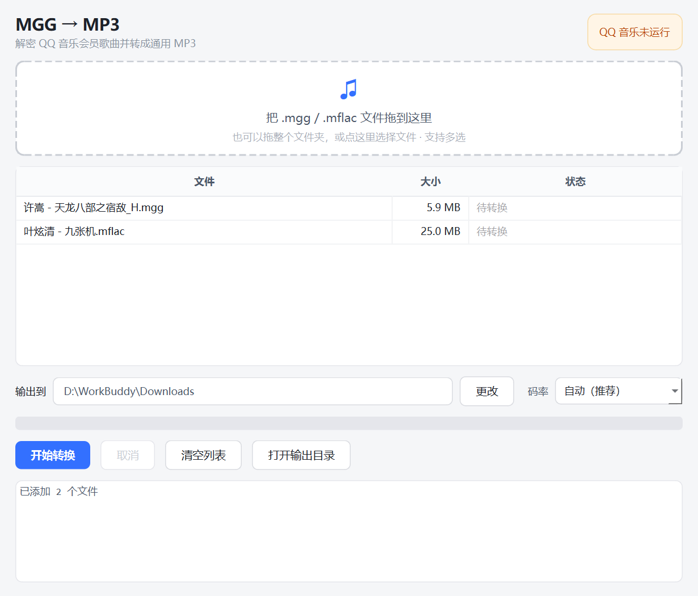

# MGG → MP3

把 QQ 音乐下载的加密音频（`.mgg` / `.mflac` 等）转成通用 MP3 的 Windows 桌面小工具。
拖拽批量转换，**不需要任何密钥**，也不需要联网上传文件。



## 特性

- **拖拽即用** — 拖入文件或整个文件夹，批量排队转换
- **不开源密钥** — 不抓包、不破解密钥，由 QQ 音乐客户端自己解密（原理见下）
- **智能码率** — 按源码率自动选 320 / 192 / 128 kbps，避免"79 kbps 源转 320"这种白白翻四倍体积
- **自动整理** — 去掉 `_H` / `_L` 音质后缀，写入歌曲名 / 歌手 ID3 标签
- **全程本地** — 无上传、无网络请求、无遥测
- **无需 ffmpeg** — 用 `soundfile` + `lameenc` 完成解码与编码

## 快速开始

### 1. 装依赖

需要 Python 3.10+。

```bash
git clone https://github.com/hongsedezhi/mgg2mp3.git
cd mgg2mp3
python -m venv .venv
.venv\Scripts\pip install -r requirements.txt
```

### 2. 打开 QQ 音乐并登录

这一步不能省——见下方「为什么必须开着 QQ 音乐」。

### 3. 启动

双击 **`启动 MGG转MP3.bat`**（会自动用项目里的 `.venv`）。
也可以直接 `python app.py`。

然后把 `.mgg` / `.mflac` 拖进窗口，点「开始转换」。
输出目录默认是 `音乐\mgg2mp3`，可点「更改」换成任意位置，设置会被记住。

## 为什么必须开着 QQ 音乐

QQ 音乐 PC 客户端 **19.57 版之后**，下载的加密文件里**不再写入解密密钥**，文件尾部
只剩一个歌曲 MID。所以任何"纯离线解密"工具——格式工厂、各种在线转换站、老版本
unlock-music——对这类文件都无效，它们根本拿不到密钥。

本工具的做法是 **Frida 借壳解密**：

```
mgg 文件  ──►  QQMusic.exe 进程内的 EncAndDesMediaFile  ──►  明文 OGG/FLAC  ──►  MP3
              （QQMusicCommon.dll，客户端自带的解密引擎）        （soundfile+lameenc）
```

用 Frida 把 `hook_qq_music.js` 注入正在运行的 `QQMusic.exe`，调用客户端自己的
`EncAndDesMediaFile::Open / GetSize / Read`，让客户端用**你账号的权限**去服务器取密钥并
解密，再把明文音频读出来。

换句话说：**工具本身没有破解能力**，它只是让客户端把「你已经有权播放的内容」解密给你。
所以不需要输入密码、不需要 Cookie、不需要上传文件。

旧版客户端下载的、**内嵌了密钥**的文件不受此限制，可以纯离线转换（不注入、不开客户端）。

## 码率是怎么定的

默认「自动」，按**源码率**决定输出码率：

| 源码率 | 输出 MP3 |
|---|---|
| ≥ 150 kbps | 320 kbps |
| 100–150 kbps | 192 kbps |
| < 100 kbps | 128 kbps |

有损转有损，输出码率高于源码率不会增加任何信息量，只是把文件撑大。文件名后缀一般能
看出音质：`_H` 高品质（约 186 kbps）、`_L` 标准音质（约 79 kbps）。
也可以在界面里手动锁定 128 / 192 / 320。

## 支持格式

```
.mgg  .mgg0  .mgg1  .mggl
.mflac  .mflac0
.qmc0  .qmc2  .qmc3  .qmc4  .qmc6  .qmc8  .qmcflac  .qmcogg
```

## 项目结构

| 文件 | 作用 |
|---|---|
| `app.py` | PySide6 界面（拖拽、队列、进度、日志） |
| `core.py` | 解密 → 解码 → 编码 的流程编排，码率策略，ID3 标签 |
| `qmc_decrypt.py` | QMC 格式解析与解密（见「致谢」） |
| `frida_mode/` | Frida 注入引擎：`hook_qq_music.js` + Python 封装 |
| `启动 MGG转MP3.bat` | 双击启动（无控制台窗口） |

## 常见问题

**报「QQ 音乐未运行」**
先启动客户端并确认已登录、能正常播放该歌曲，再点转换。界面上方的徽章会实时提示状态。

**报 `Frida 借壳解密失败` / 找不到 `EncAndDesMediaFile`**
客户端大版本更新后可能改了导出的 C++ 符号，需要适配 `hook_qq_music.js` 里的签名匹配。
也有可能是安全模块拦截了注入，重启客户端一般能恢复。

**会员过期了还能转吗？**
不能。解密权限跟着账号走，会员失效后客户端也取不到密钥。

**能转别家的加密格式吗？**
不能，目前只处理 QQ 音乐（QMC 系）格式。

## 已知限制

- 借壳解密**仅 Windows**（依赖 `QQMusic.exe`）；纯离线解密部分跨平台。
- 只处理**你账号有权播放/下载**的文件；账号降级或会员过期会解密失败。
- 注入客户端进程有极小概率被安全模块拦截，属正常现象，重启客户端可恢复。
- 客户端更新后可能短暂失效，需等 hook 脚本适配。

## 免责声明

本项目仅供**个人学习与自用**：转换你自己合法下载、有权使用的音频，便于在无客户端
的设备上离线收听。

- 请勿传播、分发转换后的音频文件；
- 请勿用于商业用途或批量搬运；
- 使用本工具产生的一切后果由使用者自行承担。

如果你喜欢某首歌，请在 QQ 音乐买下它、或者买张演唱会门票。

## 致谢

- [mzj3920/qqmusic-decrypt](https://github.com/mzj3920/qqmusic-decrypt) — `qmc_decrypt.py` 的来源，
  算法参照 [unlock-music](https://git.unlock-music.dev/um) 的 Rust 实现移植
- [yllhwa/decrypt-mflac-frida](https://github.com/yllhwa/decrypt-mflac-frida) — 借壳解密思路的原始实现
- [ericjuice/music-decryptor](https://github.com/ericjuice/music-decryptor) — 简化版参考
- [unlock-music](https://git.unlock-music.dev/um) — QMC 算法文档与测试向量

详见 [NOTICE.md](NOTICE.md)。

## License

[MIT](LICENSE)（仅覆盖本项目自有代码；第三方组件版权归原作者，见 NOTICE.md）
